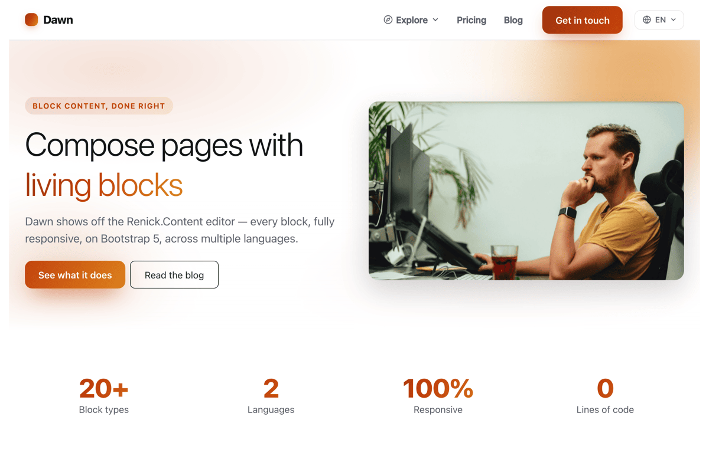

# Dawn

**Dawn** (package `Renick.Dawn`) is a modern, minimalist showcase theme for the [Renick.Content](https://www.renick.io/en/content-plugin) block editor on OctoberCMS. It puts every block through its paces across real marketing pages and a Tailor-powered blog, on Bootstrap 5, with an autumnal palette. The frontend is branded simply **Dawn**.

> **License:** Dawn (this theme) is MIT licensed — see [LICENSE.md](LICENSE.md). The Renick.Content **plugin** is licensed separately and is **not** covered by this MIT license.



## What it demonstrates

- **The whole block catalog** rendered through the `renickContent` component: heading, richtext, image, gallery, video, slider, cta, card, card-grid, accordion, timeline, map, pdf, quote, button, section, grid/column, spacer, anchor, testimonials, form/form-field, download and info-banner.
- **Six theme-supplied custom blocks** in [`content-blocks/`](content-blocks/) — hero, hero-numbers, features, pricing-table, data-table and blog-slider — registered automatically by the plugin's theme discovery and offered in the editor's "Dawn" picker group.
- **Bootstrap 5 + block CSS/JS** injected automatically by the component's asset combiner — the theme ships no CDN links.
- **A blog with no external plugin**, modelled purely with Tailor blueprints. Posts store their body in a `contenteditor` field and render it with the block renderer. Overview page has tag filtering and pagination.
- **Multisite i18n** — one theme across per-locale sites with a language-picker dropdown, `hreflang` alternates, and localized page titles/descriptions. The reference install ships **English (primary) + German**; Spanish translations are included and one blueprint/site away.
- **SEO** — per-page title, meta description, canonical, Open Graph, Twitter Card, `hreflang`, and JSON-LD (`WebSite` site-wide, `BlogPosting` on posts).
- **Responsive + tasteful motion** — gradient hero, subtle scroll reveals and float, all gated behind `prefers-reduced-motion`. No horizontal overflow from 390px up.
- **Turbo View Transitions** — same-origin navigations cross-fade via October's Turbo router (v4.3+); browsers without the View Transitions API degrade to an instant swap. Controlled by the **Page view transitions** theme customize setting (on by default; set it off to fall back to plain page loads).
- **Mobile off-canvas menu** — below the navbar breakpoint the nav slides in as an off-canvas panel with a backdrop, a close button and full keyboard/`aria-expanded` support, built without the Bootstrap Offcanvas JS so it stays Turbo-safe.
- **Optional mega menu** — the per-site `Dawn\Menu` global switches the header between the automatic page-tree nav and a freely composed mega menu (balloon selector; the form changes with the mode). First-level entries are repeater **groups**: a *page link* (page finder: Dawn\Page entries, blog posts, CMS pages or free URLs — site-aware resolution) or a *category* — deliberately not a link — whose full-width disclosure panel (W3C APG pattern: chevron button, `aria-expanded`, Escape returns focus) pairs the sub-links with an optional **hero content card** (image, formatted text, button; left/right side configurable per item). Every entry and sub-link can carry an optional **Lucide icon**, picked with Renick.Content's reusable `rciconpicker` backend widget (~1,700 sprite icons, searchable) and rendered via the now-global `rc_icon()` markup function (`|raw`). On mobile the panel folds into the off-canvas as an accordion with links and card stacked.

## Pages

| URL (English site) | Page | Highlights |
|---|---|---|
| `/en` | Landing | hero, hero-numbers (stats), slider, features, testimonials, blog-slider, CTA |
| `/en/about` | About | timeline, accordion, gallery, quote, video, hero-numbers |
| `/en/pricing` | Pricing | pricing-table tiers, data-table, FAQ-variant accordion, CTA |
| `/en/contact` | Contact | form (form-field children), map, CTA |
| `/en/blog` | Blog index | post cards, tag filter, pagination |
| `/en/blog/:slug` | Blog post | cover, meta, block-rendered body (incl. info-banner, download, PDF), article SEO |

Imprint and privacy pages are seeded too (hidden from the nav). German is served at `/de/...`; Spanish UI translations are included and a `dawn_es` site is one site row away.

## Install & activate

Install Dawn from the OctoberCMS Marketplace like any other theme (**Settings → Front-end theme**, or `php artisan theme:install Renick.Dawn`).

From a fresh October install, the whole sequence is:

```bash
php artisan project:set <your-project-id>
php artisan october:migrate
php artisan project:sync         # installs the plugin + theme, locks Dawn, creates the child theme
php artisan plugin:check
php artisan theme:seed renick-dawn
```

That is all — the last command leaves you with a working, fully populated EN/DE site. You do **not** need `theme:use` or `translate:scan`; see [Why there is a `-child` theme](#why-there-is-a-child-theme) below.

### Why there is a `-child` theme

Anything installed through Composer — which includes every Marketplace theme — is managed by October, so `project:sync` runs `theme:check`, which:

1. writes a `.themelock` file into `themes/renick-dawn/`, making it **read-only** (your next theme update would otherwise overwrite your edits), and
2. creates **`themes/renick-dawn-child/`**, a child theme (`parent: renick-dawn`) that starts empty.

The child is the theme you customise and the theme your sites run; everything it does not define falls back to Dawn. A site pointed at the locked parent instead fails every request with `The theme renick-dawn is locked`, so `theme:seed` binds the seeded sites to the child for you.

Seed with the **parent** directory name (`renick-dawn`) even though the child is what runs — the seed data lives in the parent, and the seeder resolves the target theme itself.

### Seed the demo content

**A fresh install is empty** — the pages, blog and menu are *data*, not theme files, so until you seed them the backend shows no pages and the frontend has nothing to render. Seed with either:

- **Backend:** *Settings → Front-end theme → Manage → Seed Content*, or
- **CLI**, from the project root:

  ```bash
  php artisan theme:seed <theme-folder>
  ```

> [!IMPORTANT]
> `theme:seed` takes the theme's **directory name under `themes/`**, not its `Renick.Dawn` code. That name depends on how you installed:
>
> | Installed via | Folder | Command |
> |---|---|---|
> | Marketplace, `theme:install`, Composer | `themes/renick-dawn/` | `php artisan theme:seed renick-dawn` |
> | Manual unzip / this repo | `themes/dawn/` | `php artisan theme:seed dawn` |
>
> Composer's `october-theme` installer always writes `themes/{vendor}-{name}/`, so a Marketplace install is `renick-dawn`. Passing the wrong one fails with *"The theme dawn does not exist."* Check with `php artisan theme:list`.

Seeding creates the EN/DE sites and binds them to the theme they should run, imports the Tailor blueprints into `app/blueprints/<theme-folder>/` and migrates them, imports the frontend UI strings, pulls in the demo media (photos + PDF), and creates the EN/DE marketing pages + blog with their multisite counterparts pre-linked (no `tailor:propagate` needed). It is idempotent — re-running `theme:seed` updates records in place rather than duplicating them, and never overwrites a translation or a site name you have edited.

> [!WARNING]
> Updating in place means a re-run resets the seeded demo pages, posts and menu to the shipped content: an edited title or block on a seeded record is overwritten. Re-seed only a demo you have not customised.
>
> **Updating to Dawn 1.0.6** adds the appointment-request demo (`/appointment`, `/de/termin`), which only a seed creates. On an untouched demo, re-run `theme:seed`; on a customised site, add a page with the *Submission Form* block pointing at the `Dawn\AppointmentRequest` blueprint instead. Dawn 1.0.6 requires Renick.Content 1.0.7.

> [!NOTE]
> Frontend UI strings live in the RainLab.Translate message store and are imported **by the seed**. `php artisan translate:scan` is not needed and will not do the job on its own: it reads the *active* theme, which on the command line means the `ACTIVE_THEME` value in `.env` — still October's stock `demo` unless you change it by hand, because `theme:use` writes the site row rather than the env file.

## Multisite

Per-locale `System\Models\SiteDefinition` rows drive the languages, all bound to this theme. `theme:seed` creates two from [`seeds/data/sites.json`](seeds/data/sites.json):

| Code | Locale | Route | Notes |
|---|---|---|---|
| `dawn_en` | `en` | *(root)* | English (primary) — adopts the install's existing root site rather than adding a second one |
| `dawn_de` | `de` | `/de` | German |

A site that already exists under one of those codes keeps its own name and routing; only its theme binding is refreshed. Spanish UI strings ship in `translate/es.yaml` — adding a `dawn_es` site at `/es` lights the third locale up without further theme work.

The layout (`layouts/default.htm`) builds the language-picker dropdown and `hreflang` alternates from the enabled sites that share this theme, de-duplicated to one entry per locale. UI strings use the `{{ 'key'|_ }}` filter (RainLab.Translate); translations live in `translate/*.yaml` and are imported by `theme:seed`. The `Dawn\BlogPost` blueprint uses `multisite: all`, so one entry is shared across every site with independently editable per-site values — `theme:seed` imports the EN and DE copies pre-linked (no `tailor:propagate` needed).

## Blueprints (Tailor)

Five blueprints ship under [`seeds/blueprints/`](seeds/blueprints/) and are copied to `app/blueprints/<theme-folder>/` (so `app/blueprints/renick-dawn/` on a Marketplace install) + migrated by `theme:seed` (see [seeds/README.md](seeds/README.md)):

- `Dawn\BlogTag` — `type: entry`
- `Dawn\BlogCategory` — `type: structure`
- `Dawn\BlogPost` — `type: stream`, drafts on, with `excerpt`, `cover` (mediafinder), `content` (**`contenteditor`**), `category`/`tags` relations, and `meta_title`/`meta_description`.
- `Dawn\Page` — the block-composed marketing pages (contenteditor body plus nav/footer/SEO fields).
- `Dawn\Theme` — a `type: global` settings record (brand, blog layout, footer) editable under the backend's Theme menu.
- `Dawn\Menu` — a `type: global` per-site menu record (normal page-tree nav vs. composed mega menu with page-finder links, nested repeater).

The single-post page renders the stored document with ``, which also injects the block CSS/JS. The overview paginates with `->paginate(6)` and preserves the `?tag=` filter across pages.

## Static Pages

`layouts/static.htm` declares the `staticPage` component, so it is selectable by RainLab.Pages. It turns off the stock content field (`useContent = 0`) and declares `{variable type="contenteditor" name="content"}`, so the page content is composed with blocks on RainLab.Pages 2.x and 3.x alike, independent of the Static Pages switch in the Content Editor settings. The document is stored in the page markup and renders through this theme's chrome. Pages that still hold HTML open read-only in the block editor. The static layout ships the same Turbo View Transitions wiring as the default layout.

## Structure

```
themes/dawn/                  # `themes/renick-dawn/` on a Marketplace install
├── theme.yaml, version.yaml
├── assets/css/theme.css      # theme layer: autumn palette, motion, components
├── assets/css/offline-mall-integration.css  # OFFLINE.Mall shop pages (loaded by the scaffolded shop layout only)
├── assets/js/offline-mall-integration.js    # shop pages: filter offcanvas, sign-in and product tabs, keyboard filters
├── templates/mall/           # shop layout, category page + partial overrides the Renick.Content scaffold copies in
├── assets/js/theme.js        # off-canvas mobile nav, language dropdown, scroll reveal
├── assets/images/dawn/       # credited Unsplash demo photos (see CREDITS.md)
├── assets/files/             # research-paper.pdf (blog PDF demo)
├── layouts/
│   ├── default.htm           # full chrome + SEO head + block assets
│   └── static.htm            # RainLab.Pages-compatible layout
├── partials/
│   ├── seo/head.htm          # title, OG, Twitter, canonical, hreflang, JSON-LD
│   ├── site/{header,footer,page-render,page-seo}.htm
│   └── site/paths.php        # dawn_path()/dawn_asset() — never hardcode the theme folder
├── pages/                    # index, page (Dawn\Page renderer), blog, blog-post, 404
├── content-blocks/           # theme-supplied blocks: hero, hero-numbers, features, pricing-table, data-table, blog-slider
├── lang/                     # backend blueprint and block labels (en/de/es.json)
├── translate/                # frontend UI strings for RainLab.Translate (en/de/es.yaml)
├── skills/                   # create-child-theme Claude skill
└── seeds/                    # October-native theme seed: data.yaml + data/*.json, blueprints/, media/
```

## Build a child theme

Dawn ships a Claude skill, [`skills/create-child-theme/`](skills/create-child-theme/), that scaffolds a new OctoberCMS child theme inheriting from Dawn (`theme.yaml` `parent: <dawn-folder>` — the parent's **directory** name, so `renick-dawn` on a Marketplace install) and overriding only a colour scheme, corner style, page set, optional blog and font — everything it doesn't override falls back to Dawn. The skill travels with the theme; a thin pointer under `.claude/skills/create-child-theme/` makes it discoverable in Claude Code. Ask for "a Dawn child theme" (or run `/create-child-theme`) to use it.

## Troubleshooting

**The backend shows no pages, menu or blog posts after installing.**
The demo content is data, not theme files — run the seeder (see [Install & activate](#seed-the-demo-content)). If `php artisan theme:seed dawn` reports *"The theme dawn does not exist."*, you are on a Marketplace/Composer install: use the real folder name, `php artisan theme:seed renick-dawn` (confirm with `php artisan theme:list`).

**Every page 500s with `The theme renick-dawn is locked`.**
A site is pointed at the read-only parent theme instead of `renick-dawn-child` (see [Why there is a `-child` theme](#why-there-is-a-child-theme)). Fix it under **Settings → Sites** by setting each site's theme to `renick-dawn-child`, or re-run `php artisan theme:seed renick-dawn`, which rebinds every seeded site but also resets the seeded demo content (see the warning under [Seed the demo content](#seed-the-demo-content)). Never delete `.themelock` to work around this — the next theme update would overwrite your edits.

**The frontend shows raw keys like `dawn.front.nav.home` instead of labels.**
The RainLab.Translate messages were not imported. Run `php artisan theme:seed renick-dawn` (the seed imports them) followed by `php artisan cache:clear`. Running `translate:scan` instead is not enough — see the note under [Seed the demo content](#seed-the-demo-content).

**Blocks render as “Block “hero” could not be rendered.”**
Dawn's own blocks live in `themes/renick-dawn/content-blocks/`, and the site runs the child theme. Renick.Content 1.0.3+ follows the parent chain for theme blocks; on an older plugin, update it.

**The frontend 500s with `require_once(.../themes/dawn/partials/site/…): Failed to open stream`.**
Fixed in Dawn 1.0.1. Earlier versions hardcoded `themes/dawn/` in the layouts and pages, which only resolved when the theme folder happened to be named `dawn` — every Marketplace install gets `themes/renick-dawn/` instead. Update the theme; no workaround needed. (Renaming the folder to `dawn` also worked, but Composer recreates `renick-dawn` on the next theme update.)

**The frontend renders unstyled.**
Same root cause as above and fixed in the same release — the combined stylesheet pointed at `~/themes/dawn/assets/css/theme.css` and silently dropped out when the folder was named differently.

**The backend's *Pages* menu item shows a broken-image icon.**
Same cause, fixed in Dawn 1.0.1 (the blueprint referenced an SVG under `themes/dawn/`). Re-run `theme:seed` after updating to refresh the copy in `app/blueprints/`.
